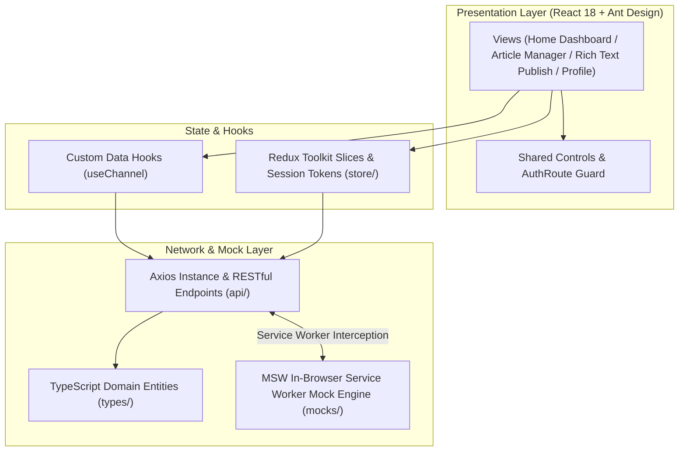

[简体中文](README.md) | English

# Blog Management System · 知识博客系统

**A modern, high-performance web platform for technical knowledge creation, sharing, and profile management.**

`blog_management_system_v1` is an engineering-focused knowledge publishing and blogging system. Refactored around a modern stack (Vite + React 18 + TypeScript), it pairs Ant Design 5 and Redux Toolkit with ECharts analytics and Mock Service Worker (MSW)—delivering a fully featured, offline-first client experience that runs seamlessly without external backend services.

---

## Core Capabilities

* **Full-Spectrum Authentication**:
  * Username/password login, email verification code flows with debounce timers, and interactive captcha challenges;
  * Integrated password strength validation, confirmation checks, and instant account registration.
* **Telemetry Dashboard & Reading Experience**:
  * **ECharts Analytics**: Tracks 3-day readership curves and engagement statistics;
  * **Curated Article Catalog**: Column-based taxonomy, status filtering (Draft/Published), and fluid pagination.
* **Structured Content Creation (ReactQuill)**:
  * Embedded ReactQuill rich-text editor supporting headings, code formatting, inline images, and draft auto-saving.
* **Social Engagement**:
  * Article upvoting, bookmark collections, and threaded comment sections ranked by hotness or recency.
* **Comprehensive User Settings**:
  * Granular management of biographical data, career history, education background, social links, and security privacy controls.

---

## Technical Architecture

| Layer | Stack | Details |
| :--- | :--- | :--- |
| **Runtime & Bundler** | Vite + React 18 + TypeScript | Instant HMR and strict end-to-end type safety |
| **UI Components** | Ant Design 5 (CSS-in-JS) | Cohesive enterprise design system |
| **State Management** | Redux Toolkit (RTK) | Modular slices managing session and auth state |
| **Routing** | React Router v6 | Declarative routing with `AuthRoute` navigation guards |
| **API & Mocking** | Axios + Mock Service Worker (MSW) | Network-level Service Worker intercepts for standalone local runs |
| **Visualizations** | Apache ECharts | Responsive telemetry charts |

---

## Quick Start

### 1. Installation & Initialization

```bash
# Install dependencies
npm install

# Initialize MSW Service Worker assets in public directory
npx msw init public/
```

### 2. Development Server

```bash
npm run dev
```

Navigate to `http://localhost:5173` in your browser.

### 3. Demo Credentials
* **Username**: `v`
* **Password**: `v`
* **Captcha**: `v`
*(Email verification code is mocked as `123456`)*

---



* **`api/`**: Axios client configuration, interceptors, and typed REST functions
* **`components/`**: Reusable widgets and `AuthRoute` navigation guards
* **`hooks/`**: Custom application hooks (such as channel categorization fetching)
* **`mocks/`**: MSW browser database, request handlers, and initial seed articles
* **`pages/`**: View layouts (Article table CRUD, Braft rich-text publishing, account center)
* **`router/`**: React Router structure and navigation hooks
* **`store/`**: Redux Toolkit state slices (token management, profile persistence)
* **`types/`**: Article domain contracts, status enums, and user payloads

---

## License

This project is open-sourced under the [MIT License](LICENSE).
